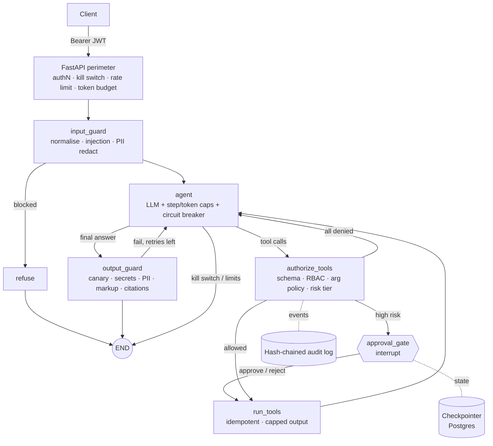

# Architecture

## Why the graph is shaped this way

* **Guards are nodes, not prompts.** A prompt can be talked out of a rule; a graph edge cannot.
* **`authorize_tools` is separate from `run_tools`.** Validation + policy happen on the *proposed* call;
  nothing with side effects runs until the call is allowed (and approved, if high risk).
* **`approval_gate` has no side effects.** LangGraph restarts an interrupted node from its first line
  on resume, so anything before `interrupt()` would run twice. Side effects live in `run_tools` and are
  idempotent per `tool_call_id` as a second safety net.
* **Every `tool_call` gets exactly one `ToolMessage`** (denied / rejected / executed) so providers never
  see orphaned calls.
* **Identity enters at the API only.** `principal` is rebuilt from the verified JWT on every request and
  placed in graph state; tools receive it via `ToolContext`, never as a model-controlled argument.
* **State is durable.** With a Postgres checkpointer an approval can wait hours across restarts/deploys.
  `thread_id = tenant:user:client_thread` so a guessed id never reaches another user's state.

## Trust boundaries

| Content | Trust | Handling |
|---|---|---|
| JWT claims (after verification) | trusted | source of identity/roles |
| User message | untrusted | normalised, injection-checked, PII-redacted |
| Retrieved docs, tool output, web content | untrusted | sanitised, delimited, "data not instructions" |
| Model output | untrusted | output guard, strict tool schemas, policy before action |

## Extending

* **New tool:** add args model + handler + `ToolSpec` in `tools/registry.py`, grant it to roles in
  `policy.ROLE_TOOLS`, add tests (including a denial test and a red-team case). Pick the risk tier
  honestly: anything irreversible, financial or external → `Risk.HIGH`.
* **Real model:** `AGENT_LLM_MODEL=anthropic:<model>` (install `.[anthropic]`) or `openai:<model>`.
* **Real vector store:** replace `KnowledgeStore.search`, keep tenant/role filtering *inside the query*.
* **Multi-replica:** move `RateLimiter`, `TokenBudget`, `ApprovalRegistry` to Redis/Postgres.
